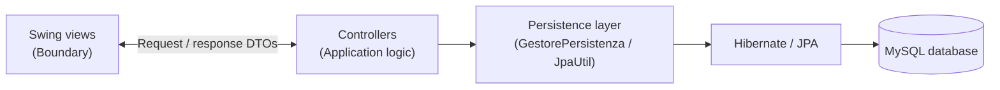

# Medical Clinic Management System

**Java desktop application | Software Engineering group project**

A desktop application developed for a university Software Engineering project at the **University of Naples Federico II** (academic year 2025/2026). It explores how a multidisciplinary medical clinic could manage appointments through a single system, with separate workflows for patients, doctors, and administrators.

The project covers more than the implementation itself: our team worked on requirements analysis, UML modelling, database design, application development, and testing.

> **Project scope:** This is an academic prototype built with Java Swing, not a deployed web application or software intended to manage real patient records.

## What the application does

The interface changes according to the user's role.

### Patients

- Register and sign in to a personal account.
- Browse medical specializations and their associated doctors.
- Check available appointment slots and book a visit.
- Review upcoming and previous appointments in their personal area.

### Doctors

- Access a dedicated area with their appointment schedule.
- View the patient information associated with booked visits.
- Update an appointment's status, including completed visits and no-shows.

### Administrators

- Open a dashboard with appointment statistics for a selected date range.
- Explore booking activity and summaries by medical specialization.

When a booking is confirmed, the application also creates a confirmation notification **record in the database**. It does not currently send an email or SMS.

## Tech stack

| Area | Technologies |
| --- | --- |
| Language and desktop UI | Java 25 (configured), Java Swing, IntelliJ IDEA GUI Designer |
| Build and dependencies | Maven |
| Database | MySQL 8, Hibernate ORM / JPA |
| Local development | Docker Compose, `.env` configuration |
| Authentication | BCrypt password hashing, JWT-based session tokens |
| Testing | JUnit 5, Mockito |
| Design and version control | UML, Visual Paradigm, Git, GitHub |

## Architecture and design

The project follows a **Boundary–Controller–Entity–Database (BCED)** structure, with **Data Transfer Objects (DTOs)** used to exchange information between application components.



- **Boundary:** screens and user interaction, including login, registration, booking, patient area, doctor area, and administrator dashboard.
- **Controller:** authentication, availability searches, doctor lookup, booking operations, and reporting logic.
- **Entity:** domain models such as `Paziente`, `Medico`, `Prenotazione`, and `FasciaOraria`.
- **Database:** persistence operations and JPA/Hibernate configuration.
- **DTO:** request and response objects passed between layers.
- **Utils:** application navigation, session handling, password utilities, and test-data initialization.

Our design process included use-case diagrams, class diagrams, sequence diagrams, and an entity–relationship model. The complete documentation is linked below.

## Repository structure

```text
medical-clinic-management-system/
├── Documentation/
│   └── Documentazione_IS.docx       # Requirements, UML, design and testing report
├── JavaProject/
│   └── Ambulatorio/
│       ├── src/
│       │   ├── main/java/com/ambulatorio/
│       │   │   ├── boundary/        # Swing screens and .form files
│       │   │   ├── controller/      # Application use cases
│       │   │   ├── database/        # Persistence layer
│       │   │   ├── dto/             # Request and response DTOs
│       │   │   ├── entity/          # Domain and JPA entities
│       │   │   ├── exceptions/      # Application exceptions
│       │   │   ├── utils/           # Shared utilities
│       │   │   └── Main.java
│       │   └── test/java/           # Unit tests
│       ├── .env.example
│       ├── docker-compose.yaml
│       └── pom.xml
└── VisualParadigm/                 # UML and database modelling files
```

## Getting started

### Requirements

- **JDK 25**, the version currently configured in `pom.xml`.
- **IntelliJ IDEA** with support for **Swing UI Designer `.form` files**.
- **Docker Desktop** or Docker Engine with Docker Compose.
- Maven (or the Maven integration available in IntelliJ IDEA).

### 1. Clone the repository

```bash
git clone https://github.com/flaviacavaliere/medical-clinic-management-system.git
cd medical-clinic-management-system/JavaProject/Ambulatorio
```

### 2. Configure the environment

Create a local `.env` file from `.env.example`. For example, in PowerShell:

```powershell
Copy-Item .env.example .env
```

Or on macOS/Linux:

```bash
cp .env.example .env
```

Edit `.env` and set the database name, database user, passwords, and `JWT_SECRET_KEY`. Use **your own development credentials** and a **JWT signing secret of at least 32 characters**. Do not commit the `.env` file.

**Important:** The current database connection in `JpaUtil` uses `127.0.0.1:3306`, so keep `DB_PORT=3306` unless you also update the application configuration.

### 3. Start MySQL

From the `JavaProject/Ambulatorio` directory:

```bash
docker compose up -d
```

Docker Compose starts the **MySQL database container**; the Java application itself runs separately on your computer.

### 4. Open and run the application

1. Open `JavaProject/Ambulatorio` in IntelliJ IDEA as a Maven project.
2. Select **JDK 25** as the project SDK.
3. Make sure the IDE is configured to compile the Swing GUI Designer forms.
4. Set the run configuration's **working directory** to `JavaProject/Ambulatorio` so the application can read `.env`.
5. Run `com.ambulatorio.Main` from the IDE.

On startup, the application can populate an empty database with sample data for development and demonstration.

**Note:** A standalone executable JAR has not been verified. The current Maven configuration does not package a self-contained application with all the required dependencies and generated Swing forms.

## Testing

The repository includes JUnit 5 and Mockito tests for two core areas:

- **Login:** valid credentials, invalid email formats, missing users, and incorrect credentials.
- **Appointment booking:** successful booking, missing inputs, and unavailable time slots.

With the project configured, the test suite can be launched through IntelliJ IDEA or with:

```bash
mvn test
```

The presence of these tests does not imply full test coverage; the complete build and test suite have not been independently verified in a clean environment.

## Project documentation

The [full Software Engineering report](Documentation/Documentazione_IS.docx) documents the requirements, use cases, UML diagrams, architecture, design choices, and testing activities.

The editable modelling files can be found in [`VisualParadigm/`](VisualParadigm/).

## My contribution

I contributed primarily to the **patient appointment-booking workflow**, including work on the booking interface, appointment availability and calendar logic, the booking controller, and the patient's personal area. I also participated in the UML modelling and the collaborative development process.

Working on these features helped me connect requirements and design diagrams to actual Java code, and gave me experience coordinating changes through Git and GitHub.

This was a **team project**: these contributions are not a claim of exclusive authorship of the entire application.

## Current limitations and possible improvements

This repository represents a university prototype rather than a production-ready clinical system. In particular:

- The delivered interface is a **Java desktop application**, not the web/mobile interface envisioned in some early requirements.
- Confirmation notifications are saved internally; automated email/SMS delivery and appointment reminders are not available.
- Some originally specified administrative and cancellation workflows are not fully implemented.
- Booking transaction consistency, reporting logic, security logging, and broader automated testing would need further work before real-world use.

Potential next steps include completing the remaining workflows, strengthening booking transaction handling, expanding test coverage, and packaging the application for easier installation.

## Team and credits

Developed for the **Software Engineering** course at the **University of Naples Federico II** by **Flavia Cavaliere, Carlo Cirillo, Francesca D'Ambra, and Pietro Farina**.

This repository is my fork of the [original group repository](https://github.com/carlocirillo/Gruppo_IS_22), preserving the link to the team project and its development history.
